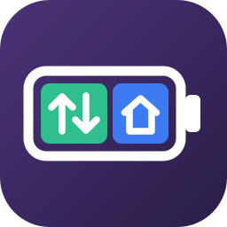

# BE Mijnbatterij (Home Assistant)

Stuurt het accuresultaat van een **Balans Energie**-installatie naar **mijnbatterij.nl**, gesplitst in *handel* en *besparing*. De integratie logt zelf in op het BE-klantdashboard. Daardoor loopt het delen door, ook als niemand het dashboard open heeft.

Rekent exact zoals de browserplugin **BE-Mijnbatterij.user.js** (≥ 1.1.0). De twee werken samen: als Home Assistant draait, verstuurt Home Assistant. Valt Home Assistant weg, dan neemt de plugin het vanzelf over.

## Browserplugin

De plugin staat in [`userscript/BE-Mijnbatterij.user.js`](userscript/BE-Mijnbatterij.user.js). Installeer hem met Tampermonkey of Userscripts; daarna werkt hij zichzelf bij via deze repository. Hij draait naast Balansenergie All-in en verandert daar niets aan.

## Installatie (HACS)

1. HACS → *Custom repositories* → deze repository toevoegen, type *Integration*.
2. **BE Mijnbatterij** installeren en Home Assistant herstarten.
3. *Instellingen → Apparaten & diensten → Integratie toevoegen → BE Mijnbatterij*.
4. Vul in:
   - je gebruikersnaam en wachtwoord van het BE-dashboard;
   - je Mijnbatterij API-sleutel (te vinden op je profielpagina).

Bij het instellen kies je of je eerst wilt proberen (**proefstand**, standaard uit). In proefstand gaat alles met `test: true` naar Mijnbatterij: het wordt gecontroleerd, maar niet opgeslagen. Alle instellingen staan als schakelaars op het apparaat *BE Mijnbatterij*: versturen, proefstand, EB op teruglevering en aFRR als handel. Zolang de proefstand aan staat, staat er een melding onder *Instellingen → Reparaties*, zodat hij niet ongemerkt aan blijft.

## Wat de integratie doet

| Interval | Actie |
|---|---|
| elke minuut | nieuwe metingen ophalen (`current-history`); kwartieren worden incrementeel opgebouwd |
| elke 2 min | prijzen archiveren (`current-prices`), live-resultaat naar `/api/live` |
| elke 30 min | de laatste 10 dagen: definitief uit BE-kwartierdata zodra BE de dag als `complete` markeert (ca. 48 uur), anders voorlopig uit de eigen metingen |
| elke 15 min | heartbeat: zie *Samenwerking met de plugin* |

**Entiteiten**
- **Sensoren:** resultaat, handel en besparing vandaag; geladen en ontladen vandaag; SOC; meetdekking; laatste live-verzending; status. De status bevat de activiteitenlog en de verstuurde dagen als attributen.
- **Knop:** *Nu versturen*.
- **Service:** `be_mijnbatterij.historie_herstellen` met `vanaf: "2026-08"`. Deze stuurt alle definitieve BE-dagen vanaf die maand opnieuw en vervangt de maandtotalen van volledig berekende maanden.

## Rekenregels

- **Verdeling per meetsegment:** het huis krijgt eerst de zonnestroom. De accu laadt eerst uit het zonne-overschot, gewaardeerd tegen de gemiste terugleverprijs, en daarna uit het net tegen de afnameprijs. Ontladen dekt eerst het huis (vermeden afname); de rest gaat naar het net (teruglevering).
- **Besparing** = ontladen naar huis × afnameprijs − het deel van de laadkosten dat daarbij hoort.
- **Handel** = ontladen naar net × terugleverprijs − de overige laadkosten + aFRR-vergoedingen.
- **batteryResult** = handel + besparing. Mijnbatterij leidt de handel daaruit af.
- **Omvormerrendement:** BE meet het accuvermogen aan de DC-kant. Gewaardeerd wordt de AC-kant: ontladen levert DC × η-uit, laden kost DC ÷ η-in. η wordt per installatie en per vermogensklasse gemeten op momenten zonder PV, want dan geldt exact: accu AC = verbruik − net. Gemeten op 19-11-2026: ontladen 0,88–0,95, laden 0,96 (rondgang ≈ 0,87). De geladen en ontladen kWh richting Mijnbatterij blijven de DC-waarden, zoals BE ze rapporteert.
- **All-in prijs:** kale BE-prijs × 1,21 ± € 0,02 opslag, plus energiebelasting op afname. Tot en met 2026 komt de EB ook terug op teruglevering (saldering).
- **Prijs per kwartier:** de effectieve kwartierprijs van BE, als die betrouwbaar is (minstens 0,05 kWh netstroom en hooguit € 1,50/kWh kaal). Anders de vastgelegde marktprijs (onbalans, aFRR of day-ahead). Alleen als laatste redmiddel het daggemiddelde; een dag met meer dan 2 uur daggemiddelde gaat als `invalid` mee.

## Prijzen

Sinds 17-11-2026 geeft BE alleen nog voor een deel van de kwartieren een prijs. Ontbrekende onbalansprijzen vullen plugin en integratie aan met de publieke minuutprijzen van Tenergy, op dezelfde manier als Balansenergie All-in (per kwartier volgens de regeltoestand). BE gaat altijd voor. De plugin leest daarvoor de Tenergy-cache van All-in; de integratie haalt de pagina zelf elke minuut op.

## Samenwerking met de browserplugin

Beide zetten achter de notitie van elk dagrecord een label:

```
[BEMB v=1.2.2 bron=ha|browser type=be|cache dekking=99.8 kwal=97.9 actief=2026-11-19T09:30:00+01:00]
```

- **Heartbeat:** Home Assistant zet elke 15 minuten `actief=<tijd>` in één dagrecord.
- **Plugin past zich aan:** ziet de plugin een heartbeat van hooguit 40 minuten oud, dan verstuurt hij geen live meer en vult hij alleen nog dagen aan: dagen die er nog niet staan, of die hij duidelijk nauwkeuriger heeft (bijvoorbeeld van vóór de HA-installatie). De pagina toont dan "Home Assistant verstuurt". Is de heartbeat ouder, dan verstuurt de plugin weer alles zelf.
- **Wie wint per dag:**
  - *definitief* (BE) gaat altijd voor *voorlopig*;
  - *voorlopig* vervangt *voorlopig* alleen bij minstens gelijke meetdekking;
  - *definitief* vervangt *definitief* alleen bij minstens gelijke nauwkeurigheid (`kwal`): het aandeel kwartieren waarvan de verdeling over huis en net uit eigen metingen komt en de prijs echt bekend is (niet het daggemiddelde). Zonder eigen metingen van een dag moet een verzender de BE-kwartieren schatten, en dat is minder nauwkeurig;
  - zo vult de bron met de meeste meetdata een dag in.
- **Eén live-verzender:** kan Home Assistant zijn heartbeat nergens kwijt (de plugin heeft alle recente dagen nauwkeuriger, bijvoorbeeld vlak na de installatie), dan stuurt hij ook geen live; de status toont dan "browserplugin verstuurt". Zodra HA zelf volledige dagen heeft, neemt hij het over.
- **Proefstand:** in proefstand stuurt Home Assistant geen heartbeat, dus neemt de plugin niets over.
- **Plugin-override:** in de plugin kun je *Altijd zelf versturen* kiezen.

## Privacy

Je BE-wachtwoord staat in de configuratie van Home Assistant (`.storage/core.config_entries`), net als bij andere integraties met een wachtwoord. De BE-sessie gebruikt een eigen cookie-opslag.

## Ontwikkelen

```
pip install pytest-homeassistant-custom-component
pytest
```

De tests draaien de volledige integratie tegen nagebootste BE- en Mijnbatterij-servers.
